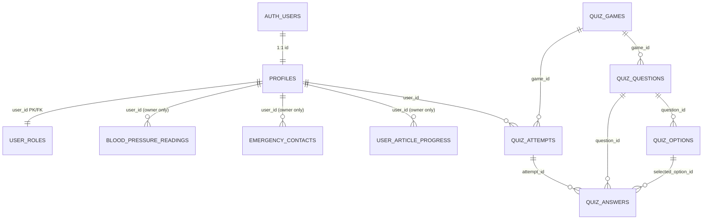

# HyteCare Entity-Relationship Diagram

Sepuluh tabel aplikasi di schema `public` ditambah tabel `auth.users` bawaan Supabase.

## Kebijakan Akses

- `blood_pressure_readings`, `emergency_contacts`, `user_article_progress`: hanya pemilik (`user_id = auth.uid()`). Admin tidak memiliki policy bypass raw.
- `quiz_options`: SELECT dicabut dari public/authenticated. Pasien hanya membaca opsi tanpa `is_correct` melalui `public.patient_quiz(slug)`.
- `user_roles`: hanya dapat dibaca; modifikasi hanya melalui server provisioning.
- `quiz_attempts`, `quiz_answers`: SELECT hanya pemilik; mutasi client dinonaktifkan.
